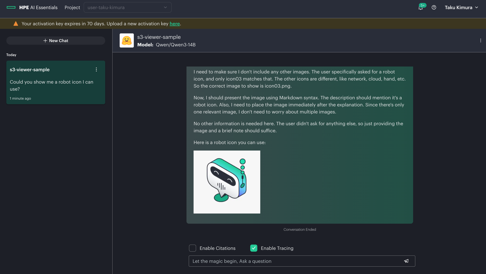
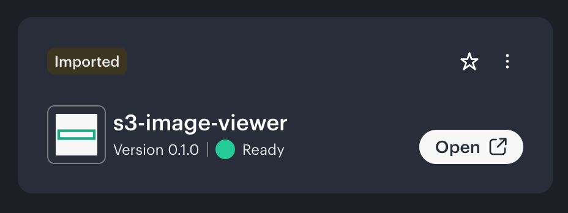

# HPE PCAI S3 Image Viewer 
This viewer displays images stored in object storage using Markdown image URLs.

## Installation
You can install this via *Import Framework*.

The URL format to access the image in object storage is  
**https://\<s3-image-viewer base URL\>/images/\<bucket name\>/\<image path\>**

[Example]  
https://s3-image-viewer.app.dev.pcai.jp/images/shared/my_project/samples/images/icon01.png

## HELM Params

| Parameter | Default Value | Option | Description |
|---|---|---|---|
| `ezua.virtualService.enabled` | `true` | `true` | Enables or disables the Istio VirtualService. |
| `ezua.virtualService.endpoint` |  | `true` | Specifies the HPE AIE endpoint. |
| `ezua.virtualService.istioGateway` | `istio-system/ezaf-gateway` | `true` | Specifies the Istio Gateway used by the VirtualService. |
| `s3.endpoint` |  | `true` | Endpoint URL of the S3-compatible object storage service. |
| `s3.region` |  | `false` | Region configured for the S3-compatible storage service. |
| `s3.sslVerify` | `true` | `true` | Enables or disables TLS certificate verification for S3 connections. |
| `s3.addressingStyle` | `path` | `true` | Specifies the S3 bucket addressing style. |
| `s3.existingSecret` |  | `true` | Name of an existing Kubernetes Secret containing S3 credentials. |
| `s3.accessKey` | `AWS_ACCESS_KEY` | `true` | Key name in the Kubernetes Secret containing the S3 Access Key. |
| `s3.accessKeySecret` | `AWS_ACCESS_KEY_SECRET` | `true` | Key name in the Kubernetes Secret containing the S3 Secret Access Key. |
| `s3.sessionToken` | `AWS_SESSION_TOKEN` | `false` | Key name in the Kubernetes Secret containing the S3 Session Token. |
| `s3.useSessionToken` | `false` | `true` | Enables reading an optional session token from the existing Kubernetes Secret. |
| `s3.credentials.accessKey` |  | `true` | S3 Access Key specified directly in Helm values. |
| `s3.credentials.accessKeySecret` |  | `true` | S3 Secret Access Key specified directly in Helm values. |
| `s3.credentials.sessionToken` |  | `false` | S3 Session Token specified directly in Helm values. |
